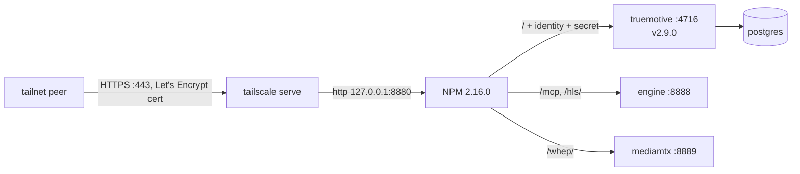

# turbo-1 — prod

Linux host, tailnet name `turbo-1.mastodon-adder.ts.net` (tailnet IP `100.124.160.30`; an older, offline machine called `turbo` also exists on the tailnet). Checkout: `~/src/mediamesh`, TMD at `~/src/truemotive-desktop`. Observed live over SSH on 2026-11-24.

Acceptance: every required row in the [punch list](../../punch-list/MATRIX.md), column turbo-1. **First instance to be fixed.**

## State at 2026-11-24 (late, at parity with mahoney-mac)

Re-check any row with `verify.sh` run on the host (see [instance sanity](../../punch-list/MATRIX.md)); this page goes stale. Reach the host with `ssh -i ~/.ssh/id_rsa_ish -o IdentitiesOnly=yes chris@turbo-1.mastodon-adder.ts.net` (the key is not in the default agent).

| Item | State |
|---|---|
| TMD | v2.9.1 built from tag `v2.9.1-beta` (`05fd62f8`) in the clean worktree `~/src/tmd-v2.9.1-beta`; `.env` `TRUEMOTIVE_DESKTOP_PATH` and `TRUEMOTIVE_GIT_SHA` point there and the image revision label matches. Healthy, 0 restarts, only `127.0.0.1:4715` published. The "This backend" host entry holds the public address (`https://turbo-1.mastodon-adder.ts.net`), and the backend tests and uses its own engine address regardless (2.9.1, TRU-36). Rollback: image `mediamesh-truemotive:rollback-v2.9.0-20261124` (the 2.9.0 build, `7cda41b0`), the older `rollback-v2.8.2-20261124`, and the worktrees `~/src/tmd-v2.9.0-beta` and `~/src/tmd-v2.8.2`; a rollback has not been drilled (TRU-15). Backup before the 2.9.1 move: `~/pre-v2.9.1-2026-11-24/` |
| mediamesh | `main` @ `6f12d4d` (PRs #83 to #87), no tracked changes. Old local edits are in `git stash` and `~/pre-remediation-2026-11-24/`. Backup before the parity change: `~/pre-parity-2026-11-24/` |
| Front door | `tailscale serve` `:443` → `127.0.0.1:8880` only. NPM 2.16.0 with 4 locations from `edge/proxy-host.json`: `/` → `truemotive:4716` with identity, `/mcp` and `/hls/` → `engine:8888`, `/whep/` → `mediamtx:8889` |
| Proven | `sanity.sh` 26 pass / 2 warn / 0 fail; `verify.sh` with `--media` 22 pass / 1 warn / 0 fail / 2 skip: pin, migrations 001–010, `/`, `/tv/`, tailnet identity, spoof tests, a real MCP handshake on `/mcp`, `/hls/`, WHEP signalling, live NPM equals the committed config. The one warn (Z1) looks for a backup under the Mac's path |
| Exposure | UI and control ports (`8080`, `5173`, `8787`, `8888`, `9997`) are loopback only and closed from the Mac. The rest published beyond loopback is exactly the documented media ports (13 entries). WHEP media: `MTX_WEBRTC_ADDITIONAL_HOSTS` is set to the tailnet IP and name |
| Restart policy | every long-running service is `unless-stopped`. `rist-receiver` and `rist-receiver-dante` show `RestartCount 1` (`sanity.sh` K2 warns), cause not investigated |
| Channels | one running: `stream-unavailable`, the built-in fallback channel, which the API starts on every boot |
| Not yet | E3–E5 (`/mediamesh/`, `/spacecom/`, `/decisions/`, TRU-5 phases 2 to 4); B4 restore drill; G2 rollback drill (TRU-15); G3 stale-network review; F3 UDP media ports (RIST, SRT, livekit range) and E7 video in a real browser; D12 blank-NPM drill on this host |
| Leftovers | the unused `NPM_ADMIN_PASSWORD` line is still in `.env` (a weak, documented password from an earlier attempt; remove it, not done); `~/src/truemotive-desktop` still has 12 uncommitted files and is no longer used by the build; disk is 89% full, about 97 GB free, and Docker reports about 80 GB of reclaimable images and 46 GB of unused volumes; adjacent services ([details](../../system/07-adjacent-services.md)) |

## Why TMD was restarting

Layered causes, detailed in [remediation/TMD-RESTART-LOOP.md](../../remediation/TMD-RESTART-LOOP.md): listener collision on main, a stale network attachment on the existing container, and local edits that moved the published port away from where `tailscale serve` points.

## Next on this host

Path parity with the Mac for the three remaining paths (E3–E5), then the drills: restore (B4), rollback (G2), blank NPM (D12). Order and evidence: [punch list](../../punch-list/MATRIX.md).
