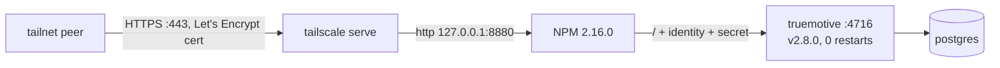

# turbo-1 — prod

Linux host, tailnet name `turbo-1.mastodon-adder.ts.net` (tailnet IP `100.124.160.30`; an older, offline machine called `turbo` also exists on the tailnet). Checkout: `~/src/mediamesh`, TMD at `~/src/truemotive-desktop`. Observed live over SSH on 2026-11-24, read-only.

Acceptance: every required row in the [punch list](../../punch-list/MATRIX.md), column turbo-1. **First instance to be fixed.**

## State at 2026-11-24 (after the fix)

| Item | State |
|---|---|
| TMD | v2.8.0 (`d6d700b2`, built from `~/src/tmd-v2.8.0`), healthy, 0 restarts. Target v2.8.2 is not tagged yet |
| mediamesh | branch `fix/tmd-listeners-postgres-and-npm-edge` (PR #83). Old local edits are in `git stash` and `~/pre-remediation-2026-11-24/` |
| Front door | `tailscale serve` `:443` → `127.0.0.1:8880` only; `:8444` removed |
| Proxy | NPM on `127.0.0.1:8880` (admin `8881`), one proxy host, one location `/` |
| Proven | `/`, `/tv/`, tailnet identity, forgery tests ([log](../../punch-list/LOG.md)) |
| Still open | other paths (E3–E7), UI/control ports still on `0.0.0.0` (F), TMD v2.8.2 pin, PR #83 merge |
| Leftovers | unused `NPM_ADMIN_PASSWORD` line in `.env` from an earlier attempt (a weak, documented password; remove it); `~/src/truemotive-desktop` still has uncommitted edits; adjacent services ([details](../../system/07-adjacent-services.md)) |

## Why TMD was restarting

Layered causes, detailed in [remediation/TMD-RESTART-LOOP.md](../../remediation/TMD-RESTART-LOOP.md): listener collision on main, a stale network attachment on the existing container, and local edits that moved the published port away from where `tailscale serve` points.

## Next on this host

Merge PR #83 and move the checkout back to `main`; pin TMD v2.8.2 once it is tagged; prove the other paths (E3–E7) and close the UI/control ports (F). Order and evidence: [punch list](../../punch-list/MATRIX.md).
