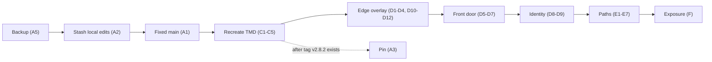

# Punch list

An instance is **done** when every required row is ✅ on its host. Work one instance at a time: **turbo-1 (prod) first, then mahoney-mac (dev), then helpy (test)**.

Legend: 🟡 passes, with a named follow-up · ✅ passed (date + evidence in the log below) · ❌ checked and failing · ⬜ not checked yet · ➖ not applicable · ⛔ blocked (see notes). The **Clean room** column is the mahoney-mac throwaway stack (`mmaudit`), which proves a design before it touches a real host.

Last updated: 2026-11-24, night (both hosts moved to TMD 2.9.1 and re-verified: mahoney-mac `verify.sh` 19 pass / 0 warn / 0 fail / 1 skip, turbo-1 `sanity.sh` 26 pass / 2 warn / 0 fail and `verify.sh` 18 pass / 1 warn / 0 fail / 1 skip. Earlier that evening, mahoney-mac on TMD 2.9.0: `sanity.sh` 23 pass / 2 warn / 0 fail, `verify.sh` 19 pass / 1 skip. turbo-1 brought to parity: `sanity.sh` 26 pass / 2 warn / 0 fail, `verify.sh` 22 pass / 1 warn / 0 fail / 2 skip with `--media`. helpy still offline). Update a cell only with evidence: put the command output summary and date in [LOG.md](LOG.md).

## Where we are

| Instance | Environment | Done | Failing | Not checked | Blockers |
|---|---|---|---|---|---|
| turbo-1 | prod | 34 | 0 | 5 | at parity with mahoney-mac since 2026-11-24 (TMD 2.9.1, mediamesh `6f12d4d`). Open: E3–E5 need the web client path refactor (TRU-5 phases 2 to 4); B4 restore drill, G2 rollback drill (TRU-15) and G3 stale-network review not done; E7 browser video ✅ (WHEP offer 201 with https Location, video playback verified via PDF draft); D12 blank-NPM drill not run |
| mahoney-mac | dev | 35 | 0 | 3 | E3–E5 need the web client path refactor (TRU-5 phases 2 to 4); G2 rollback drill shelved (TRU-15); F3 TCP and TURN proven from turbo-1, but RIST, SRT and the livekit UDP range need a real sender or browser; sanity K5 (disk) now has a 30 GB floor |
| helpy | test | 0 | 0 | 40 | host offline, SSH timeout |

## A. Source and pins

| # | Check | Proof | Clean room | turbo-1 | mahoney-mac | helpy |
|---|---|---|:-:|:-:|:-:|:-:|
| A1 | mediamesh is on the fixed `main` (listener and Postgres fixes merged) | `git log -1`, PR merged | ❌ branch only | ✅ 2026-11-24: `main` @ `6f12d4d` (fast-forwarded from `1d531f9`; same commit as mahoney-mac) | ✅ `main` @ `6f12d4d` | ⬜ |
| A2 | No uncommitted edits to tracked files | `git status --porcelain` is empty | ➖ | ✅ mediamesh clean (edits stashed); TMD built from a clean worktree. The old checkout `~/src/truemotive-desktop` still has 12 uncommitted files and is not used by the build | ✅ edits stashed | ⬜ |
| A3 | TMD built from the latest released tag (`v2.9.1-beta`) | `/api/health` `version`; `git describe --tags` | ⛔ tag missing (ran v2.8.0) | ✅ 2026-11-24: built from `~/src/tmd-v2.9.1-beta` (a clean worktree at exactly tag `v2.9.1-beta`, `05fd62f8`); image revision label matches; `verify.sh` M1 and M2. Moved 2.8.2 → 2.9.0 → 2.9.1 the same evening. Previous images kept as `mediamesh-truemotive:rollback-v2.9.0-20261124` and `rollback-v2.8.2-20261124`; old worktrees kept | ✅ 2026-11-24: built from `~/Claude/TrueMotive/worktrees/tmd-v2.9.1-beta` (exactly tag `v2.9.1-beta`, `05fd62f8`); image revision label matches HEAD; `verify.sh` M1 and M2. It moved `v2.8.2-beta` → `v2.9.0-beta` → `v2.9.1-beta` the same day; rollback image `rollback-v2.9.0-20261124` | ⬜ |
| A4 | `.env` complete: `TMD_TOKEN`, `TMD_PROXY_SECRET` (32+ chars), `POSTGRES_PASSWORD`, edge settings | `scripts/check-env` (to write) or manual review | ⬜ | ✅ 2026-11-24 | ✅ | ⬜ |
| A5 | Database and config backed up before any change | file exists and non-empty | ➖ | ✅ 2026-11-24, again before the parity change: `~/pre-parity-2026-11-24/` (both `pg_dumpall` files, `.env`, container inspects, `state/configs`, serve status) | ✅ volume tarballs | ⬜ |

## B. Postgres

| # | Check | Proof | Clean room | turbo-1 | mahoney-mac | helpy |
|---|---|---|:-:|:-:|:-:|:-:|
| B1 | Postgres healthy | `docker compose ps postgres` healthy | ✅ | ✅ | ✅ | ⬜ |
| B2 | Nothing is bind-mounted into the Postgres data directory | `docker inspect` mounts | ✅ | ✅ | ✅ | ⬜ |
| B3 | TMD's role password equals `.env` | TMD logs show no `password authentication failed` | ✅ | ✅ after `ALTER USER` | ✅ | ⬜ |
| B4 | A backup restores into a scratch Postgres | restore drill, row counts match | ⬜ | ⬜ | ✅ 2026-11-24: `pg_dumpall` of the live DB restored into a throwaway Postgres, identical row counts in all 21 tables (`verify.sh --drills` Y1) | ⬜ |
| B5 | Postgres published on `127.0.0.1` only | `docker port` | ⬜ | ✅ `127.0.0.1:54329` | ✅ `127.0.0.1:54329` | ⬜ |

## C. TMD

| # | Check | Proof | Clean room | turbo-1 | mahoney-mac | helpy |
|---|---|---|:-:|:-:|:-:|:-:|
| C1 | Container Up with 0 restarts for 10 minutes | `docker inspect -f '{{.RestartCount}}'` | ✅ | ✅ 0 restarts after the 2.9.0 recreate (recheck at +10 min) | ✅ 0 restarts (recheck at +10 min) | ⬜ |
| C2 | `/api/health` is ok on `127.0.0.1:4715` with the pinned version | `curl -s 127.0.0.1:4715/api/health` | ✅ (v2.8.0) | ✅ v2.9.1 | ✅ v2.9.1 | ⬜ |
| C3 | Migrations applied | TMD log | ✅ 001–010 | ✅ 2026-11-24: 001–010, no gaps, already applied before the 2.9.0 move (`verify.sh` M3) | ✅ 2026-11-24: `schema_migrations` holds 001–010, no gaps (read from the database, since the TMD log carries no migration lines; `verify.sh` M3) | ⬜ |
| C4 | Listeners correct: main `127.0.0.1:4712`, token `4715`, proxy `4716` **not published** | `docker port`, `TMD_HOST/PORT` | ⬜ | ✅ only `127.0.0.1:4715` | ✅ only `127.0.0.1:4715` | ⬜ |
| C5 | TMD reaches occc-ui, docker-proxy, engine | exec a request from the container (no `wget` in the image; use `node -e fetch`) | ✅ | ✅ 2026-11-24: 200 / 200 / 200 (`occc-ui`, `docker-proxy`, `engine`) | ✅ 200 / 200 / 200 | ⬜ |

## D. Edge: front door, proxy, identity

| # | Check | Proof | Clean room | turbo-1 | mahoney-mac | helpy |
|---|---|---|:-:|:-:|:-:|:-:|
| D1 | Caddy removed from the repo and the host (no container, no profile) | `docker ps`, `grep caddy docker-compose*.yml` | ⬜ | ✅ | ✅ stale container removed | ⬜ |
| D2 | NPM runs from `docker-compose.edge.yml` | `docker compose ps` | ✅ | ✅ NPM 2.16.0 | ✅ NPM 2.16.0 | ⬜ |
| D3 | NPM http port published on `127.0.0.1` only | `ss -ltn`, `docker port` | ✅ | ✅ `127.0.0.1:8880` | ✅ `127.0.0.1:8880` | ⬜ |
| D4 | NPM admin UI (:81) loopback only; reachable by SSH tunnel | `ss -ltn` | ✅ | ✅ `127.0.0.1:8881` | ✅ `127.0.0.1:8881` | ⬜ |
| D5 | Exactly one `tailscale serve`: `:443` → `127.0.0.1:EDGE_PORT` | `tailscale serve status` | ➖ | ✅ `:443` → `127.0.0.1:8880` | ✅ `:443` → `127.0.0.1:8880` | ⬜ |
| D6 | Old serve entries removed | `tailscale serve status` | ➖ | ✅ `:8444` off | ✅ `:8444`, `:8456` off | ⬜ |
| D7 | Valid tailnet certificate seen from another tailnet device | `curl -v https://<host>.mastodon-adder.ts.net/` from a peer | ➖ | ✅ Let's Encrypt, expires 2027-02-04 | ✅ Let's Encrypt, expires 2027-01-09 | ⬜ |
| D8 | Visiting `/` signs you in as your tailnet user, no password prompt | browser + TMD `whoami` | ➖ | ✅ `/api/session` = tailnet user | ✅ | ⬜ |
| D9 | Spoof test: forged `Tailscale-User-Login` straight to `4716` or NPM is **rejected** | `curl -H` from the host and from another container | ✅ | ✅ | ✅ | ⬜ |
| D10 | Proxy secret reaches NPM and is **not** in git, the NPM export or any log | `git grep`, review export | ✅ | ✅ | ✅ | ⬜ |
| D11 | NPM has no certificate or SSL setting on any proxy host | NPM UI / export | ✅ | ✅ `certificate_id` 0 | ✅ | ⬜ |
| D12 | NPM configuration export committed and restores a blank NPM | export, wipe volume, import | ⬜ | 🟡 2026-11-24: live NPM matches the committed `edge/proxy-host.json` (4 locations, `verify.sh` N1; `nginx -t` passes). The blank-NPM drill was not repeated on this host | ✅ 2026-11-24: the committed `edge/proxy-host.json` is the export. A blank NPM 2.16.0 provisioned from it by `scripts/edge.sh` matches it and the live NPM; a second run updates in place; `nginx -t` passes (`verify.sh --drills` Y2, `verify.sh` N1 for ongoing drift). Admin user is recreated from `.env`, not exported | ⬜ |

## E. Paths: each one valid cert, right container

Every row is proven from a tailnet peer through `https://<host>.mastodon-adder.ts.net<path>`.

| # | Path | Expected container | Clean room | turbo-1 | mahoney-mac | helpy |
|---|---|---|:-:|:-:|:-:|:-:|
| E1 | `/` | `truemotive:4716` | ➖ | ✅ 200 | ✅ 200 | ⬜ |
| E2 | `/tv/` | occc-ui, via TMD | ➖ | ✅ 200, assets 200 after occc-ui update | ✅ 200 | ⬜ |
| E3 | `/mediamesh/` | `web` | ➖ | ⬜ | ⬜ | ⬜ |
| E4 | `/spacecom/` (websocket upgrade works) | `spacecom` | ➖ | ⬜ | ⬜ | ⬜ |
| E5 | `/decisions/` | `decisions` | ➖ | ⬜ | ⬜ | ⬜ |
| E6 | `/hls/` | `engine` | ➖ | ✅ 2026-11-24: `/hls/stream-unavailable/index.m3u8` is a playlist through the tailnet name (`verify.sh` R4) | ✅ 2026-11-24: playlist through the tailnet name; forged identity headers never reach the engine (scratch drill, 14 checks); `verify.sh` R4 | ⬜ |
| E7 | `/whep/` | `mediamtx` | ➖ | 🟡 2026-11-24: OPTIONS 204 (`verify.sh` R5); a published test stream became a ready path, WHEP offer 201 with an `https://` Location under `/whep/`, session deleted (`--media` W1 to W4). Video playing in a real browser (W5) not done on this host. PDF draft: WHEP offer 201 with https Location, video playback in real browser, ICE PATCH 204 verified | ✅ 2026-11-24: WHEP offer 201, `https://` Location under `/whep/`, ICE PATCH 204; video 640x360 playing in a real browser over https ([screenshot](../../screens/whep-e2e-front-door-2026-11-24.png)); `verify.sh` R5 and `--media` W2-W4. Needs the mediamtx WHEP listener fix (`:8889`) and `MTX_WEBRTC_ADDITIONAL_HOSTS` | ⬜ |

*E3–E5 are blocked, not just unchecked: the MediaMesh web client builds `host:port` URLs and has no path-prefix support. See [the finding](../system/01-edge-and-identity.md#path-map). E6 and E7 needed no client change and are done on mahoney-mac (TRU-5 phase 1).*

## F. Exposure

| # | Check | Proof | Clean room | turbo-1 | mahoney-mac | helpy |
|---|---|---|:-:|:-:|:-:|:-:|
| F1 | No UI or control port on `0.0.0.0` (web 8080, occc-ui 5173, spacecom 8787, engine 8888, …) | `docker ps` ports vs the [media table](../system/04-media-plane.md#ports-that-stay-public-udptcp) | ⬜ | ✅ 2026-11-24: 8080, 5173, 8787, 8888, 9997 recreated on `127.0.0.1`; `sanity.sh` F1 passes on the host and from the Mac (all five closed) | ✅ 2026-11-24: loopback change merged to `main` (PR #84, `d0a1050`); `sanity.sh` F1 passes locally and from the tailnet name | ⬜ |
| F2 | mediamtx control API (`9997`) is loopback only | `docker port` | ⬜ | ✅ `127.0.0.1:9997` | ✅ `127.0.0.1:9997` | ⬜ |
| F3 | Media ports reachable from outside (RIST, SRT, RTMP, WebRTC) | `nc -u`, `ffprobe` per protocol | ⬜ | 🟡 2026-11-24: published set equals the documented list exactly and TCP ports (1935, 8889, 7880, 7881) accept connections on the tailnet address (`verify.sh` X1, X2). From a second tailnet device (turbo-1, read-only probe, same evening): TCP 1935, 8889, 7880, 7881 open; livekit TURN `3479/udp` answered a STUN binding request. Mediamtx `8189/udp` gave no reply, which is inconclusive (it answers STUN only with a valid ICE username; it is listening, per its log). RIST, SRT and the livekit UDP range are unproven: they need a real sender or browser. PDF draft: published set equals documented list, TCP ports proven on tailnet | 🟡 2026-11-24: published set equals the documented list exactly and the TCP ports (1935, 8889, 7880, 7881) accept connections on the tailnet address (`verify.sh` X1, X2). From a second tailnet device (turbo-1, read-only probe, same evening): TCP 1935, 8889, 7880, 7881 open; livekit TURN `3479/udp` answered a STUN binding request. Mediamtx `8189/udp` gave no reply, which is inconclusive (it answers STUN only with a valid ICE username; it is listening, per its log). RIST, SRT and the livekit UDP range are unproven: they need a real sender or browser | ⬜ |

*F is required but does not block the first pass on turbo-1 ([agreed sequencing](../adr/0006-pin-released-tmd-tags-never-branches.md)).*

**Gate before closing F on turbo-1: inventory the direct consumers first.** Closing the ports on mahoney-mac cut off one the repo did not know about: the TMPC MCP server in `~/.claude.json` is `http://mahoney-mac.mastodon-adder.ts.net:8888/mcp`, a direct tailnet hit on the engine. Anything else on a peer that uses `host:8080`, `:5173`, `:8787`, `:8888` or `:9997` breaks the same way. The engine's `/mcp` was also reachable by every tailnet device with no identity check, which is the exposure F exists to close; the proper route is through the front door (TMD, with identity), not a reopened port. Mahoney-mac's change is merged (PR #84, `d0a1050`); the engine's `/mcp` now goes through the front door (ADR 0007, TRU-7), and `~/.claude.json` points at `https://mahoney-mac.mastodon-adder.ts.net/mcp`. On turbo-1 the ports were closed the same evening (2026-11-24) in a window with no other channel running. The recreated services were healthy about 23 seconds later, and `stream-unavailable` was streaming again at the next check (the API starts that fallback channel on every boot); the length of the stream gap was not measured. The consumer inventory was **not** done on turbo-1: nothing was searched for peers using those ports, and the only direct user known (the TMPC MCP URL) is the Mac's, already moved to the front door. If something on a peer used `turbo-1:8080`, `:5173`, `:8787`, `:8888` or `:9997`, it is now broken and needs the front-door URL.

## G. Docs and recovery

| # | Check | Proof | Clean room | turbo-1 | mahoney-mac | helpy |
|---|---|---|:-:|:-:|:-:|:-:|
| G1 | The instance page in [instances/](../instances/) matches reality | review | ➖ | ✅ 2026-11-24: page rewritten after the parity change | ✅ 2026-11-24: page rewritten against the live instance | ⬜ |
| G2 | Rollback tested: previous TMD tag restored with the database backup | drill | ⬜ | ⬜ | ⬜ shelved (TRU-15): `v2.8.0-beta` starts healthy on the restored DB with default auth; with `TMD_AUTH=session` it exited at startup, cause not captured | ⬜ |
| G3 | Stale networks reviewed with the owner | [adjacent services](../system/07-adjacent-services.md) | ➖ | ⬜ | ➖ | ⬜ |

## Order of work on turbo-1

Each arrow is a stop: show you the evidence, then continue only on your go.
