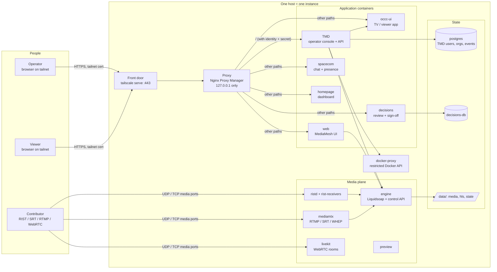

# System overview

TrueMotive is a live-production platform: operators build streaming channels in a browser, an engine runs them, and viewers and contributors connect over standard media protocols. Everything runs as containers on one host, reached over a private Tailscale network.

## The whole product on one page

Media ports (the arrow from Contributor) do **not** go through the front door. They are published straight from the host and are the one deliberate exception to "everything enters through :443".

## Layers

| Layer | One-line job | Page |
|---|---|---|
| Edge and identity | Get a tailnet visitor to the right container and tell TMD who they are | [01](01-edge-and-identity.md) |
| Services | The containers and what each one owns | [02](02-services.md) |
| Data | Where state lives and what to back up | [03](03-data.md) |
| Media plane | Ingest, run and deliver audio and video | [04](04-media-plane.md) |
| Build and deploy | From repository to running container, per host | [05](05-build-and-deploy.md) |
| Operations | Backup, health, debugging | [06](06-operations.md) |
| Adjacent services | Other things on the same hosts | [07](07-adjacent-services.md) |
| Environments | dev, test, prod side by side | [08](08-environments.md) |

## Repositories

| Repo | Role | Where |
|---|---|---|
| mediamesh | The stack: compose files, engine, UI, media services, scripts | `~/Claude/TrueMotive/mediamesh` (mac), `~/src/mediamesh` (turbo-1) |
| truemotive-desktop | TMD source: `apps/server`, `apps/web`, `docker/web/Dockerfile` | `~/Claude/Projects/truemotive-desktop` (mac), `~/src/truemotive-desktop` (turbo-1) |
| occc-ui | Viewer / TV app, built into the stack | `~/Claude/TrueMotive/occc-ui` |
| TrueMotiveArchitecture | These docs | this repo |

Planned: truemotive-desktop moves into mediamesh with history ([remediation plan](../remediation/TMD-RESTART-LOOP.md#out-of-scope-until-the-above-is-verified)), after all three instances pass the punch list.
