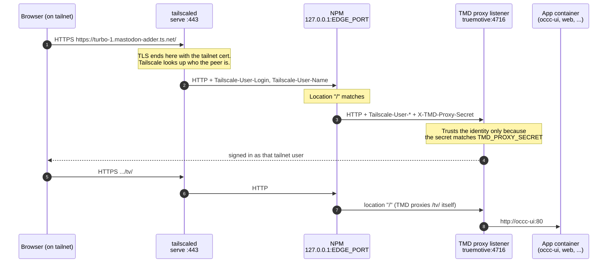
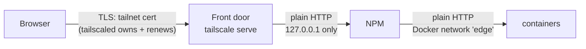
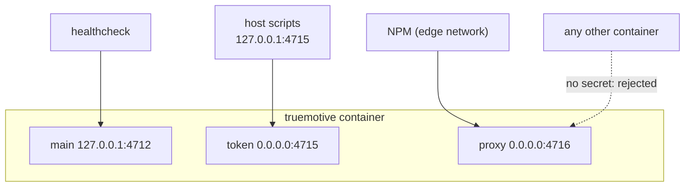

# Edge and identity

How a person on the tailnet reaches a container, and how TMD knows who they are. This is the page to read when "I can't get in" or "it thinks I'm someone else".

**The rule:** one front door per host. Everything a person uses goes in through `tailscale serve`, then the proxy, then a path. Decisions: [ADR 0001](../adr/0001-one-instance-per-host.md), [0002](../adr/0002-terminate-tls-at-the-front-door-only.md), [0003](../adr/0003-path-based-routing-behind-one-tailnet-name.md), [0004](../adr/0004-identity-is-trusted-only-with-the-proxy-secret.md), [0005](../adr/0005-nginx-proxy-manager-as-an-in-repo-edge-overlay.md).

Status: ✅ live and verified on turbo-1 (2026-11-24, [evidence](../punch-list/LOG.md)); 🟡 on mahoney-mac and helpy. Code: mediamesh PR #83 (`docker-compose.edge.yml`, `scripts/edge.sh`, `edge/`).

## The request path

## Where TLS ends, and who owns what

| Concern | Owner | Never |
|---|---|---|
| Certificate for `<host>.mastodon-adder.ts.net` | tailscaled | Do not request certificates in NPM |
| Who the visitor is | tailscaled (adds `Tailscale-User-*`) | Do not let any other hop invent identity |
| Which container gets the request | NPM locations | Do not route by hostname |
| Proving identity headers came from the proxy | `TMD_PROXY_SECRET` | Do not commit the value |

**Guidance for maintaining this.** If a page shows a certificate warning, the problem is in tailscaled (`tailscale serve status`, `tailscale cert`), never in NPM. If someone is signed in as the wrong user or nobody, the problem is the header or the secret hop between NPM and TMD. If a path 502s, it is the NPM location or the container behind it. Start from the first hop that fails.

## TMD has three listeners, and they must not overlap

TMD inside its container opens three ports. Each has exactly one job and one caller.

| Listener | Setting | Binds | Caller | Trusts |
|---|---|---|---|---|
| Main | `TMD_HOST` / `TMD_PORT` | `127.0.0.1:4712` (loopback in the container) | the container healthcheck only | session cookies |
| Token | `TMD_TOKEN_LISTEN` | `0.0.0.0:4715`, published as `127.0.0.1:4715` on the host | scripts on the host | `TMD_TOKEN` bearer token |
| Proxy | `TMD_PROXY_LISTEN` | `0.0.0.0:4716`, **never published** | NPM, over the Docker network | `Tailscale-User-Login` **plus** `X-TMD-Proxy-Secret` |

### What went wrong on 2026-11-24

mediamesh `origin/main` set `TMD_HOST=0.0.0.0` and `TMD_PORT=4715`. That put the **main** listener on the same port as the **token** listener. TMD v2.8.0 exits with status 1 and prints nothing, so the container restarted forever and nothing in the logs explained why. Separately, a Postgres access file bind-mounted into the data directory stopped fresh Postgres from initialising at all. Full audit: [remediation/TMD-RESTART-LOOP.md](../remediation/TMD-RESTART-LOOP.md).

Rules that keep this from happening again:

1. `TMD_HOST` is `127.0.0.1` and `TMD_PORT` is `4712`. Always. Session mode requires the main listener on loopback.
2. Nothing but NPM is pointed at `4716`, and `4716` is never in a `ports:` list.
3. NPM is never pointed at `4715`. That listener ignores tailnet identity, so people would see a login prompt instead of being recognised.
4. Do not edit the proxy secret in only one place. It lives in `.env` as `TMD_PROXY_SECRET` and is delivered to NPM as described below.

## NPM configuration

| Item | Value | Status |
|---|---|---|
| Image | `jc21/nginx-proxy-manager:2.16.0`, pinned | ✅ |
| Proxy host | one, named `${EDGE_HOSTNAME}`, forwards to `truemotive:4716`, SSL off (`certificate_id` 0) | ✅ turbo-1 |
| Listener | published on `127.0.0.1:${EDGE_PORT}` only (`8880`) | ✅ turbo-1 |
| Admin UI | `127.0.0.1:${EDGE_ADMIN_PORT}` (`8881`); reach it with `ssh -L 8081:127.0.0.1:8881 <host>` | ✅ turbo-1 |
| Definition in git | `edge/proxy-host.json`; `scripts/edge.sh provision` creates the admin on first run and creates or updates the proxy host. The committed file is the export | ✅ |
| Restore a blank NPM | wipe `edge_data`, run `provision` | ⬜ not drilled (punch list D12) |
| Secret delivery | `scripts/edge.sh render` writes `data/edge/snippets/tmd-proxy.conf` from `.env`; NPM's location only says `include /snippets/tmd-proxy.conf;` | ✅ proven: the secret is in no git file, NPM config, NPM database or log |
| NPM template | `edge/templates/_location.conf` replaces NPM's own with three lines changed | ✅ see below |

**The secret never goes into NPM's UI.** NPM's custom fields cannot read environment variables, so anything typed there lands in its database. The location holds only an `include`.

**Why NPM's template is overridden.** In NPM 2.16.0 a custom location stamps `X-Forwarded-Proto` with `$scheme` and replaces the `X-Forwarded-For` chain with the peer address. Behind `tailscale serve` NPM only ever sees `http`, so TMD would think the visit is plain http (it uses the header for its TV cookie's `Secure` flag) and lose the real client. The override uses NPM's own `$x_forwarded_proto` and `$proxy_add_x_forwarded_for` maps, which the default location already uses. **On every NPM version bump, diff the file against the new image's template.**

**Proven behaviours (clean room, then turbo-1):**

| Test | Result |
|---|---|
| `/api/session` through the front door from a tailnet peer | `via: tailnet`, the peer's own login |
| Peer sends a forged `Tailscale-User-Login` | ignored: `tailscale serve` overwrites it with the real login |
| Peer sends a forged `X-TMD-Proxy-Secret` | ignored: NPM overwrites it with the real one |
| Forged login straight to `truemotive:4716` | 401 |
| Other locations | identity headers and secret are stripped (`edge/…` snippet `strip-identity.conf`) |
| `X-Forwarded-Proto: https` and the client chain | survive NPM |

## Path map

| Path | Goes to | Notes | Status |
|---|---|---|---|
| `/` | `truemotive:4716` | operator console, API, identity | ✅ turbo-1 |
| `/tv/` | served by TMD itself (it proxies `TMD_TV_URL=http://occc-ui:80`) | no NPM entry needed | ✅ turbo-1 |
| `/mediamesh/` | `web:80` | MediaMesh UI | ⛔ see below |
| `/spacecom/` | `spacecom:8787` | Socket.IO, needs websocket upgrade | ⛔ see below |
| `/decisions/` | `decisions:10848` | own identity secret (`DECISIONS_PROXY_SECRET`) | ❓ base-path support unchecked |
| `/hls/` | `engine:8888` | HLS output | ❓ |
| `/whep/` | `mediamtx:8889` | WebRTC playback | ⛔ see below |

**Finding (2026-11-24): the MediaMesh web UI cannot sit behind path locations as it is.** `web/src/api.ts` builds its URLs from the page's host plus a fixed port: WHEP at `https://<host>:8446`, SpaceCom at `…:8445`, and the engine API at the baked-in `VITE_MEDIAMESH_URL` (`…:8443`). Those were Caddy's per-port HTTPS doors. With one front door there are only paths, so the client needs same-origin base paths (for example `/engine/`, `/spacecom/` with Socket.IO's `path` option, `/whep/`) or those services need their own front-door ports. This is a code change in mediamesh, not NPM configuration. Open decision in the [punch list notes](../punch-list/MATRIX.md).

A service gets a path only once it works under a prefix; until then it stays unexposed (loopback or internal).

## Tailscale pieces to know

- `tailscale serve --bg --https=443 http://127.0.0.1:8880` is the whole front door. Check with `tailscale serve status`.
- turbo-1's old `:8444` serve (token listener) is retired.
- Tagged devices (servers) do not have a user identity; visitors must be people on user-owned devices.
- Two names are in play in this tailnet: `mastodon-adder.ts.net` (yours) and `tail17a08f.ts.net` (shown for a shared peer). Use yours.

## Retired

Caddy with `caddy-tailscale` used to do the identity step by joining the tailnet as its own machine. It is removed ([ADR 0005](../adr/0005-nginx-proxy-manager-as-an-in-repo-edge-overlay.md)). Leftover Docker networks `caddy-stack_truemotive-core` and `tm-caddy_*` on turbo-1 are stale; see [adjacent services](07-adjacent-services.md).
