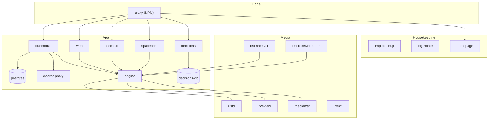

# Services

One row per container in the primary stack (`mediamesh/docker-compose.yml`). Ports are what turbo-1 showed on 2026-11-24. "Exposure" is the target after port tightening; the current state on each host is in the [punch list](../punch-list/MATRIX.md).

Status: names, ports and roles ✅ (turbo-1 `docker ps` and compose). Deep per-service pages ⬜.

## Application

| Service | Role | Listens | Target exposure | Depends on |
|---|---|---|---|---|
| `truemotive` | TMD: operator console and API, sessions, orgs, events. See [edge page](01-edge-and-identity.md#tmd-has-three-listeners-and-they-must-not-overlap) | `4712` (loopback), `4715` token, `4716` proxy | `127.0.0.1:4715` only | postgres, docker-proxy, engine |
| `truemotive-perms` | One-shot: makes the TMD config folder writable by uid 1000 | none | none | none |
| `web` | MediaMesh UI (React, served by nginx) | `80` (published `8080`) | via proxy path | engine |
| `occc-ui` | Viewer / TV app that reads the publish manifest | `80` (published `5173`) | via TMD at `/tv/` | engine |
| `spacecom` | Realtime layer: chat, presence, viewer counts, queue (Node + Socket.IO) | `8787` | via proxy path | engine |
| `decisions` | Review and sign-off app, image `truemotive-decisions:0.6.1` | `10848` | via proxy path | decisions-db |
| `homepage` | Dashboard (gethomepage v2.7.0) | `3000` | via proxy path | none |
| `docker-proxy` | Restricted Docker API (read plus start/stop/restart) so TMD never gets the raw socket | `2375` | none, internal only | none |

## Media

| Service | Role | Listens | Target exposure |
|---|---|---|---|
| `engine` | Liquidsoap plus the Node control API; runs channel graphs, serves HLS | `8888/tcp`, `9000/udp`, `9100/udp`, `9220–9222/udp` | UDP ingest stays public; `8888` via proxy |
| `engine-perms` | One-shot permissions for `data/` | none | none |
| `ristd` | RIST sender/daemon | `8889/tcp` internal, `9300–9399/udp` | UDP stays public |
| `rist-receiver` | Receives RIST from contributors, relays to engine `9100` | `9800–9801/udp` | UDP stays public |
| `rist-receiver-dante` | Same for Dante audio, relays to engine `9110` | `9810–9811/udp` | UDP stays public |
| `mediamtx` | RTMP/SRT ingest, WebRTC (WHEP) playback | `1935`, `8890/udp`, `8889`, `8189/udp`, `9997` API | media ports public; **`9997` API loopback** |
| `preview` | Preview renderer | `4720` | internal only |
| `livekit` | WebRTC SFU for call rooms (container name fixed to `livekit`) | `7880–7881`, `3479/udp`, `50100–50200/udp` | signaling via proxy; media ports public |

## Data and housekeeping

| Service | Role |
|---|---|
| `postgres` | TMD's database (`postgres:16-alpine`), published only as `127.0.0.1:54329` |
| `decisions-db` | Decisions' own Postgres, not published |
| `tmp-cleanup` | Clears temp files under `data/tmp` |
| `log-rotate` | Rotates logs |

## Not in the primary stack

| Item | Where | Status |
|---|---|---|
| Caddy | `caddy` profile in compose | removed by [ADR 0005](../adr/0005-nginx-proxy-manager-as-an-in-repo-edge-overlay.md) |
| Secondary stack | `docker-compose.secondary.yml` (older party/coturn components for rollback) | ⬜ stub |
| LiveKit agents | `docker-compose.livekit-agents.yml` | ⬜ stub |
| Decisions interim door | `docker-compose.decisions-interim.yml` | ⬜ stub, tied to the old Caddy door |
| Helpy overlay | `docker-compose.helpy.yml` | replaced by the `edge` overlay |

## Known hazards

- `livekit` has a fixed `container_name`, so two compose projects on one host cannot both run it. Clean rooms must leave it out.
- `engine` bind-mounts the repo (`.:/app`) and needs `scripts/install-api-deps.sh` after a fresh checkout.
- `mediamtx` publishes its control API on `9997`; treat that as an open admin port until it is loopback-only.
