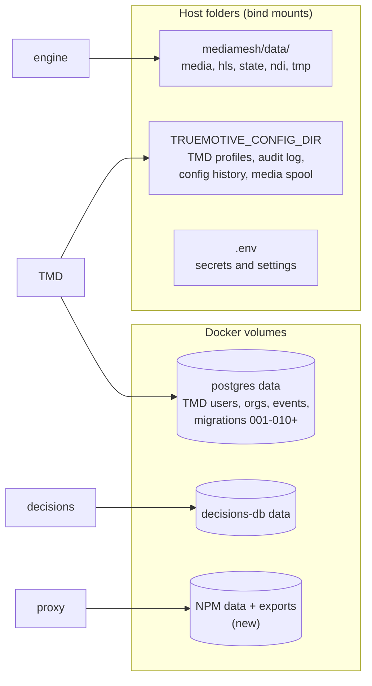

# Data and state

Where everything that must survive a rebuild lives, and what to back up. Status: layout 🟡 (from compose and the audit), sizes and retention ⬜.



| State | Lives in | Written by | Back up? | Recovery note |
|---|---|---|---|---|
| TMD database | Postgres volume | `truemotive` | **Yes**, `pg_dumpall` before every change | The password in the volume is fixed at first init. `POSTGRES_PASSWORD` changes later do nothing; use `ALTER USER`. |
| TMD config | `TRUEMOTIVE_CONFIG_DIR` (host folder) | `truemotive` | Yes | Must be writable by uid 1000 (`truemotive-perms`) |
| Decisions DB | `decisions-db` volume | `decisions` | Yes | ⬜ |
| Media library, HLS, state | `mediamesh/data/*` | `engine` | media: yes; `hls`, `tmp`: no | ⬜ retention |
| Secrets and settings | `mediamesh/.env` | a human | Yes, **separately from git** | Never committed. Per-host. |
| NPM config | `edge` data volume, plus exported JSON in the repo | NPM | export in git, data volume yes | Secrets removed from export ([edge page](01-edge-and-identity.md#npm-configuration)) |

## Rules

- **Never** bind-mount a single file over a Postgres data directory file (`pg_hba.conf`). It makes `initdb` see a non-empty directory and Postgres never starts. That is half of the 2026-11-24 outage.
- **Never** weaken Postgres authentication to `trust`. The image default (password over the network) is the standard.
- Back up before: changing compose files, recreating the Postgres container, or touching volumes.

## Backup commands (proposed, to validate in the punch list)

```sh
# database
docker exec <project>-postgres-1 pg_dumpall -U truemotive > ~/pg-backup-$(date +%F).sql
# volume copy (stack stopped or quiesced)
docker run --rm -v <project>_truemotive_postgres_data:/v -v "$PWD":/b busybox tar czf /b/pg-backup.tgz -C /v .
```
