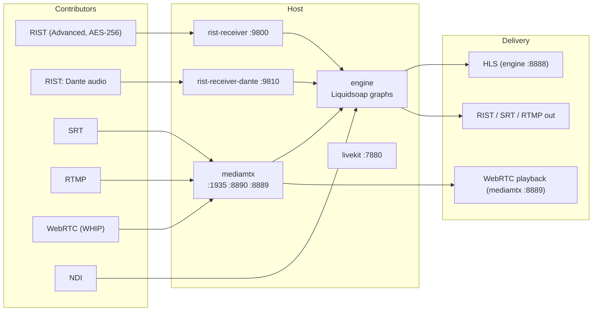

# Media plane

How audio and video get in, get processed and get out. Status: path and ports 🟡 (from compose and the repo's own ARCHITECTURE.md); per-protocol detail ⬜ stub. The authoritative deep dive is `mediamesh/ARCHITECTURE.md` (sections 5–11 and 14).

## Rules of the plane

1. **Media ports are the only things published on the LAN.** They bypass the front door by design; UI and control ports do not.
2. UDP receivers deliberately have no `depends_on: engine`. UDP is connectionless, so they can start first.
3. RIST uses the Advanced profile with a pre-shared key (`RIST_INGEST_SECRET`, `RIST_DANTE_SECRET`). Senders must match profile and key.
4. A channel compiles through a gate before it starts; a compile error stops it with a message.

## Ports that stay public (UDP/TCP)

| Port(s) | Service | Purpose |
|---|---|---|
| `9000`, `9100`, `9220–9222` udp | engine | RIST/UDP ingest |
| `9300–9399` udp | ristd | RIST |
| `9800–9801`, `9810–9811` udp | rist receivers | contributor RIST |
| `1935` tcp, `8890` udp | mediamtx | RTMP, SRT ingest |
| `8189` udp, `8889` tcp | mediamtx | WebRTC |
| `7880–7881` tcp, `3479`, `50100–50200` udp | livekit | rooms |

Anything not in this table that is published on `0.0.0.0` is a punch-list finding.

## Stubs to fill (⬜)

Per-protocol operator guide, NDI and Dante setup, the Builder and Liquidsoap catalog, and the publish manifest consumed by occc-ui.
