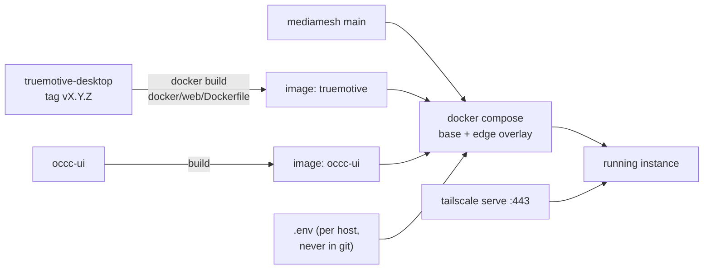

# Build and deploy

How code becomes a running instance. Status: shape 🟡, per-host procedure ⬜ until proven by the punch list.

## Inputs

| Input | Source | Per host? |
|---|---|---|
| mediamesh | git `main` (changes via PR) | same everywhere |
| TMD | git **tag** (target `v2.8.2`; see [ADR 0006](../adr/0006-pin-released-tmd-tags-never-branches.md)); path from `TRUEMOTIVE_DESKTOP_PATH` | same tag everywhere |
| Overlays | `COMPOSE_FILE=docker-compose.yml:docker-compose.edge.yml` in `.env` | same everywhere |
| Settings and secrets | `.env` | yes |
| Front door | `tailscale serve` | yes, once per host |

## Release flow (target)

1. Change lands in a branch and PR. No direct pushes to `main`.
2. Prove it in a **clean room** on dev: separate compose project, state folder and worktrees, so the real instance is not touched.
3. Run the full [punch list](../punch-list/MATRIX.md) in the clean room.
4. Tag TMD if it changed. Update the pin.
5. Apply to test, then prod, one punch-list row at a time, with a backup first.

## Known traps

- `engine` bind-mounts the repo; run `scripts/install-api-deps.sh` after a fresh checkout (it touches `api/package-lock.json`).
- `rist-receiver-dante` needs a GitHub token at build time (`scripts/build-rist-receiver-dante.sh`); running an already built image does not.
- `occc-ui` bakes `VITE_MEDIAMESH_URL` in at build time.
- Local uncommitted edits on a host drift it from the others. On turbo-1 they reached ~3,200 lines ([snapshot](../remediation/turbo-local-changes.txt)). Rule: hosts have no local edits to tracked files; per-host differences live in `.env`.
