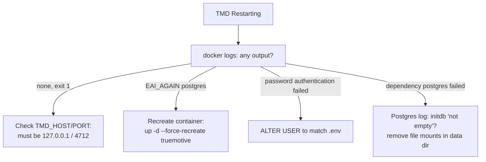

# Operations

Day-to-day commands and a first-response flow. Status: commands taken from this audit 🟡; alerting, monitoring and on-call ⬜ stub.

## Is it healthy?

```sh
docker compose ps                                  # everything Up/healthy, RestartCount 0
curl -s http://127.0.0.1:4715/api/health           # {"ok":true,"version":"<pin>",...}
tailscale serve status                             # one entry, :443 -> 127.0.0.1:<EDGE_PORT>
curl -sI https://<host>.mastodon-adder.ts.net/     # from a tailnet peer: valid cert, 200
docker inspect -f '{{.RestartCount}}' <project>-truemotive-1
```

## First response when TMD is restarting



| Symptom | Likely cause | Fix |
|---|---|---|
| Exit 1, no log lines | main and token listener on the same port | `TMD_HOST=127.0.0.1`, `TMD_PORT=4712` |
| `EAI_AGAIN postgres` while Postgres is healthy | container's network attachment is stale | recreate the container |
| `password authentication failed for user "truemotive"` | volume password differs from `.env` | `ALTER USER truemotive PASSWORD '<.env value>'`, never `trust` |
| Postgres crash-loop, `directory exists but is not empty` | a file bind-mounted into the data dir | remove the mount |
| TMD: `password authentication failed`, with the Postgres volume from an older stack | the volume's own `pg_hba.conf` is a custom file (local `peer`, loopback `trust`, no network rule) and the role password differs from `.env` | restore the image default `pg_hba.conf` in the volume (back it up first), reload, then `ALTER USER`; see [LOG](../punch-list/LOG.md) |
| `Peer authentication failed` in `docker exec psql` | same custom file, or the `pg_isready` healthcheck | use `-h 127.0.0.1`; log lines from the healthcheck are harmless |
| `container name "/livekit" already in use` | second compose project on same host | leave livekit out of clean rooms |
| Engine `Cannot find module 'express'` | fresh checkout | `scripts/install-api-deps.sh` |

## Access to NPM's admin UI

```sh
ssh -L 8081:127.0.0.1:8881 chris@<host>
# then open http://127.0.0.1:8081 on your machine
```

## Stubs (⬜)

Monitoring and alerting, log locations, restore drill, rotating `TMD_PROXY_SECRET` and `TMD_TOKEN`, upgrade and rollback of TMD, on-call.
