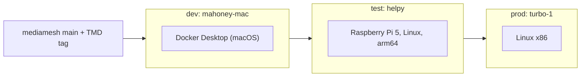

# Environments

dev, test and prod are three instances of the same stack ([ADR 0001](../adr/0001-one-instance-per-host.md)). They differ only in `.env`, hardware and who uses them.

| | dev | test | prod |
|---|---|---|---|
| Host | mahoney-mac | helpy | turbo-1 |
| OS / runtime | macOS, Docker Desktop | Linux (Pi 5), Docker | Linux, Docker |
| Tailnet name | `mahoney-mac.mastodon-adder.ts.net` | `helpy.mastodon-adder.ts.net` | `turbo-1.mastodon-adder.ts.net` |
| Checkout | `~/Claude/TrueMotive/mediamesh` | ❓ `nginxpm/` stack seen in repo notes | `~/src/mediamesh` |
| TMD at last audit | `v2.8.0` in clean room; real instance unverified | ❓ not reachable (offline 7 h on 2026-11-24) | crash-looping, ~v2.8.0-beta-4 |
| Front door today | none | NPM on 80/443 (per overlay notes) | `tailscale serve :8444` to the token listener |
| Docker caveats | `network_mode: host` does not reach the real host; use published ports | arm64 images required ❓ | none known |
| Promotion | first | second | last |

Differences that are allowed: `.env` values, published ports for local convenience on dev, and hardware limits (helpy may omit heavy services ❓). Differences that are not: compose files, TMD tag, edge design.

Per-host detail: [mahoney-mac](../instances/mahoney-mac/), [helpy](../instances/helpy/), [turbo-1](../instances/turbo-1/).
